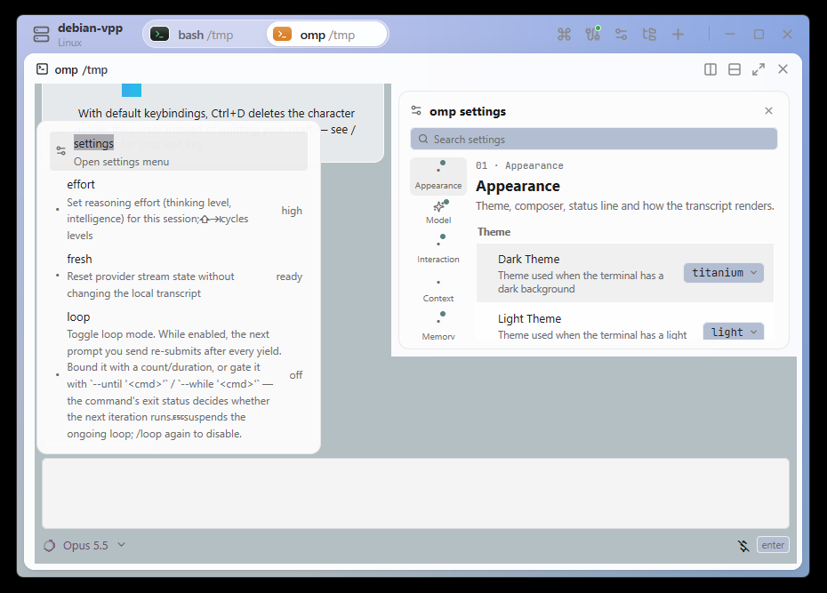

# GoRex

A replica of [Superlogical's Rex](https://www.superlogical.com/updates/public-testing-beginning)
terminal, written in Go with [MyGo](https://mygo.egoist.dev)'s native UI and its
terminal plugin (Ghostty's libghostty-vt). No webview, no cgo: one ~15 MB app.



## What it does

- **Tabs and split panes.** Every pane is a card over the window's gradient,
  with its program's icon, name and directory in its header, and buttons to
  split right, split down, zoom and close. Drag the gaps between panes to
  resize them (double-click resets a split to half).
- **Persistent sessions.** Shells run in a session server, a background
  process of the same binary (`GoRex -server`). Quit GoRex and everything
  keeps running; open it again and every tab, split and pane comes back as
  it was, programs still running. Each session's terminal lives in the
  server, a headless libghostty-vt emulator that answers its programs; the
  window shows it through frames of the screen (MyGo's `terminal.Mirror`),
  so full-screen programs and agents' interfaces (lazygit, vim, omp…) show
  exactly what the server's terminal has, also after a resize or reattach.
- **Program activity.** The server watches each terminal's foreground
  process (`tcgetpgrp`, `sysctl`, `proc_pidinfo`; on Windows, the shell's
  newest child, its command line and directory): headers and tabs name the
  program (`Node`, `Git Changes` for lazygit, `Codex`, `SSH host`…) and its
  working directory, a green dot shows a program printing, and an orange dot
  marks a pane whose program finished or rang the bell out of sight. When
  the window is in the background, a long command finishing posts a
  notification.
- **Tab icons** stack the tiles of a tab's programs, the focused pane's in
  front, as Rex does. Tabs reorder by dragging, rename by double-click, and
  have a context menu.
- **Host chip** with the machine's name and model; its popover shows the
  chip, memory, OS and the session server, and lists the hosts: click one
  to switch the window to it, ⧉ to open it in a new window, ↻ to reconnect,
  ⚙ and ✕ (on hover) for its settings and to forget it, Add Host… for a
  new one, or type `user@host` to connect to another.
- **Command palette** (⇧⌘P, Ctrl+Shift+P, or the ⌘ button): every command, and every pane
  to jump to, fuzzy-matched; the servers to switch the window to (below).
- **Remote sessions over ssh.** `GoRex ssh user@host` opens a window on
  the sessions of a GoRex server on that host, as VS Code's Remote-SSH
  does: GoRex copies the server for the host's system to `~/.cache/gorex/<id>/` there (or the host's Server folder) the
  first time, starts it, and carries every connection over one `ssh`
  (multiplexed with yamux, by `GoRex -bridge` on the host). The remote
  server keeps its state, the layout too, in `~/.config/<profile>`, the
  profile being the name of the local data directory (`GoRex`, `GoRex
  Dev`). The host chip's popover, or the palette (type `ssh user@host`),
  switches the window to another host or back to this machine. A lost
  connection comes back by itself, trying five times; a bar under the
  panes tells how it goes, with Retry once it gave up, and the Connection
  Log (also in the palette) shows what ssh said. Remote hosts run Linux
  (glibc 2.17 or later) or macOS, on amd64 or arm64. ssh logs in with
  keys or an agent, or asks, in the window, what it would ask in a
  terminal: a password, a key's passphrase, a code, whether to trust a
  host's key it has not seen. It asks again on each connect, and a login
  cancelled or refused is not retried by itself. `gorex doctor user@host`
  tells how a host takes logins. Your ssh agent is forwarded to a host
  where `~/.ssh/config` says `ForwardAgent yes`, or its Forward ssh agent
  switch in Settings, Hosts, is on, or for one window with `GoRex ssh -A
  user@host` (`-a`: not, over both): the host's sessions started since use
  it at a path that stays (`~/.config/<profile>/agent.sock`), after a
  reconnect too, while a window is connected, the latest one's agent
  first. A window opened with `GoRex ssh` quits when it is closed, on macOS
  too; the server and its sessions go on.
- **Host settings** (⚙ in the host list, Edit… in Settings, Hosts, or Add
  Host… there, in the host list or the palette): a host's name, its ssh
  destination, identity file and more ssh options (`-p 2222 -o
  ProxyJump=bastion`, which every ssh to it takes), Forward ssh agent, and
  how GoRex reaches it: with **GoRex's server** there, in the folder of the
  host's Server folder (`~/.cache/gorex` when empty; one GoRex makes is the
  user's alone, and none of another user's is used), with **plain ssh**,
  or as a **serial port** of this PC (below).
- **Plain ssh hosts.** A host where GoRex's server can't run, or that you
  want so, is reached with ssh alone: its tabs and panes run `ssh` from
  this PC, in a session server of the host's own on this PC (in
  `hosts/<user@host_port>` of the data directory), with its own tabs and
  layout, switched to from the host list as any host. Its sessions
  outlive the window, but not their connections: one that ends other than
  by logging out says so, and Enter connects it again. What needs GoRex's
  server on the host, editor tabs, its files and git, shows greyed out.
  A plain host's Command runs there instead of the login shell.
- **When GoRex's server can't run on a host** (no server for its system,
  a glibc older than 2.17, or a folder that runs no programs, as `/home`
  mounted noexec), the window does what Settings, Hosts, *When GoRex's
  server can't run on a host* says: ask (the default), with Try other
  folders (where the folder ran no programs) and Connect with plain ssh;
  try other folders, then plain ssh; or plain ssh. Other folders are
  folders of the user's own in `$XDG_RUNTIME_DIR` (or `/run/user/<uid>`),
  `/var/tmp`, `/dev/shm` and `/tmp`, the first where a script copied
  there runs. The host's settings keep what was done, the folder or plain
  ssh with why, and later connections follow them. `GoRex ssh --plain
  user@host` connects with plain ssh, and `--server` with GoRex's server,
  over the host's settings; failing logins and unreachable hosts never
  fall back.
- **Serial ports.** A serial host (Add Host…, Connect with Serial port)
  is a port of this PC, as a switch's, a router's or a board's console:
  the port, picked from a list that shows what is plugged in, each with
  its adapter's name over its path, USB IDs and serial number, and which
  port another serial host has open or is not plugged in; its speed
  (115200 by default, or any other, as 74880), framing (8N1, 7E1… or
  data bits, parity and stop bits of its own), what Enter sends (CR, CR
  LF or LF) and Backspace (DEL or BS), and local echo. Its name is the
  port's, the adapter's and the speed's, as "COM13 · Prolific PL2303 ·
  115200", until you give it one; the host chip tells the port under it
  too. Its window has the port's one session, in a session
  server of its own on this PC (`hosts/serial-…`), which keeps the port
  open while GoRex is closed; no more tabs or splits, nor editor tabs. An
  adapter unplugged is waited for, and found again by its serial number,
  or its USB IDs when it has none, at whatever path it comes back. Send
  Break (⇧⌘B, Ctrl+Shift+B; the palette, the Shell menu) sends a 300 ms
  break; Release Port closes the port for another program, and Enter in
  the pane opens it again. A port another serial host has open, the pane
  says whose, and Enter takes it over: that host's session releases it,
  as Release Port does. Settings changed in the host dialog apply to
  the open port at once. `GoRex serial <name>` opens a window on one. On
  Linux, a port of the `dialout` group (`uucp` on some systems) needs
  your user in that group, as GoRex says when it can't open one.
- **Pasting images.** A program that reads the clipboard itself (the
  Kitty clipboard protocol, as omp does) is told what a paste holds and
  takes the image, on any host: a screenshot pastes into its prompt over
  ssh. Other programs get the text.
- **Editor tabs** (the ▤ button, ⇧⌘O / Ctrl+Shift+O): a file browser of the
  host's files on the left, editors on the right that split, zoom, close
  and take the focus as terminal panes do. A click on a file opens it in
  the focused editor; with unsaved changes there, or with Enter or
  Shift+click, in a new split beside it. The editor is MyGo's: syntax
  highlighting, several carets, folding, find and replace; ⌘S / Ctrl+S
  saves through the host's server, which refuses a file something else
  changed meanwhile and asks what to do. A Changes mode shows the diff
  against the file as it was. Files are read and written on the host,
  over ssh too, through the session server; buffers live in the window,
  and unsaved changes survive a reconnect. The tab, its browser's root
  and open folders, and its panes and modes come back with the layout.
  The tree follows the host: the server watches the folders it shows
  (fsnotify) and tells every window of a file written there, by a shell
  or anything else; an open file changed on the host reloads, or, with
  edits of its own, says "changed on disk" in its header. In a git
  repository the tree marks what `git status` sees: **M** modified,
  **A** added, **D** deleted, **R** renamed, **U** untracked, **C**
  conflict, folders by the strongest inside them, ignored files dimmed.
- **Settings** (⌘, / Ctrl+,): a dialogue with a sidebar and a search over
  every row. The look of a window follows the host it shows: appearance,
  terminal colors (every Ghostty theme, with a previewer), the window's
  background (GoRex's own gradient, neutral grays, or a custom color or
  top-to-bottom gradient tinting it), font
  (any monospaced one this PC has; Nerd Font icons show under every font,
  from the embedded Symbols Nerd Font), cursor; set on a host, they apply
  from any PC. Hosts without a value of
  their own inherit this PC's Defaults. The shell, where new tabs start,
  the environment and the scrollback are the host's own; notifications,
  confirm-on-close, copy on select, reconnecting, what the window's
  title names (the host, the tab, or both) and the window's material
  (Mica, Acrylic or Tabbed on Windows 11, the macOS materials; the
  gradient goes translucent over it) are this PC's.

## Shortcuts

| macOS | Windows, Linux | |
|---|---|---|
| ⌘T | Ctrl+Shift+T | New tab |
| ⌘D / ⇧⌘D | Ctrl+Shift+D / Ctrl+Shift+E | Split right / down |
| ⌘W / ⇧⌘W | Ctrl+Shift+W | Close pane / tab |
| ⇧⌘↩ | Ctrl+Shift+Enter | Zoom the pane |
| ⌥⌘ arrows | Alt+arrows | Focus the pane in that direction |
| ⌃⌘ arrows | Alt+Shift+arrows | Move the nearest divider |
| ⌃⌘= | | Equalize panes |
| ⌘1…⌘9, ⇧⌘[ ⇧⌘], ⌃Tab | Ctrl+Shift+1…9, Ctrl+PageUp/PageDown, Ctrl+Tab | Switch tabs |
| ⇧⌘R | Ctrl+Shift+R | Rename tab |
| ⇧⌘P, ⌘P | Ctrl+Shift+P | Command palette |
| ⌘K | Ctrl+Shift+K | Clear |
| ⌘+ ⌘− ⌘0 | Ctrl+= Ctrl+- Ctrl+0 | Text size for this host; ⌘0 back to the Defaults. ⌘ or Ctrl with the wheel too |
| ⇧⌘O | Ctrl+Shift+O | New editor tab |
| ⌘S, ⇧⌘M | Ctrl+S, Ctrl+Shift+M | Save; show the file's changes (in editor tabs) |
| ⌥⌘Q | | Quit and end all sessions |
| ⇧⌘B | Ctrl+Shift+B | Send Break, on a serial port |

Elsewhere than on macOS, Control and a letter are the terminal's (Ctrl+C,
Ctrl+D, Ctrl+W…), so GoRex's shortcuts take Shift too, as copying and
pasting do (Ctrl+Shift+C, Ctrl+Shift+V), and none take Control and Alt,
which type characters (AltGr) on many keyboards. Windows' habits are
settings of this PC, on by default on Windows: Ctrl+C copies the
selection when there is one (and interrupts when there is none), Ctrl+V
pastes, Ctrl+Insert and Shift+Insert copy and paste, and a right click
pastes, or copies the selection.

## Develop and build

GoRex needs [Go](https://go.dev/dl/) 1.27+ and MyGo 0.3.0, whose CLI
`go.mod` pins as a tool:

```sh
make dev             # this platform's GoRex in dev/, with the servers for ssh hosts
make release         # go tool mygo build: the app and its installer, in build/
go tool mygo dev     # GoRex Dev, rebuilt and restarted as the code changes
go test ./...        # the server, and the view without a window
go tool mygo build   # build/darwin-arm64/GoRex.app and a .dmg
make icon            # redraw resources/icon.png from tools/mkicon/icon.svg
go run ./tools/remotepayload  # the servers for ssh hosts, in resources/remote (mygo build runs it)
```

`go get -tool github.com/egoist/mygo/cmd/mygo@latest` updates MyGo and its
CLI together.

The app keeps its state in its data directory: the server's socket and
log, `layout.json`, the host's `settings.json` and this PC's
`defaults.json`, in `~/Library/Application
Support/GoRex` for the built app and `GoRex Dev` for `mygo dev`'s, so
that developing never touches the sessions of the app you use
(`GOREX_DIR` names another directory). The sessions outlive the app, but
not a rebuild: a development build replaces a server that an older build
started, ending its sessions, which then start again in the same
directories. That goes for the servers it reaches over ssh too: the first
connection after a rebuild copies the new build to the host and restarts
the `GoRex Dev` server there, ending its sessions.

### Windows

GoRex runs on Windows 10 1809 or later, whose ConPTY runs the shells; its
data directory is `%AppData%\GoRex`. Panes run `$SHELL` when it names a
Windows program (`nu`, `C:\Program Files\Git\bin\bash.exe`), else
PowerShell (`pwsh`, then `powershell`), else `cmd`. PowerShell's `cd`
leaves its process's directory where it was, so GoRex starts it with a
prompt that sets it, wrapping the profile's own prompt: the header then
follows it, and new panes open there. The window is frameless and its
title bar draws minimize, maximize and close with the other buttons; it
resizes from its sides and bottom, not its top.

## Layout

| | |
|---|---|
| `main.go` | the app, its window, `-server` and `-bridge` |
| `bind.go`, `remotes.go` | the server a window shows: connecting, reconnecting, switching, known remotes |
| `plain.go`, `fallback.go`, `hostedit.go` | plain ssh hosts; what a window does where GoRex's server can't run; the host dialog |
| `serialhost.go`, `serialedit.go` | serial hosts: their windows, Send Break and Release Port; the host dialog's serial port |
| `state.go` | tabs, the tree of splits, panes, saving and restoring the layout |
| `editor.go`, `browser_view.go`, `editor_view.go` | editor tabs: the file browser, editor panes, opening, saving, what survives a reconnect |
| `view.go`, `tabs.go`, `host.go`, `commands.go` | the interface: title bar, tabs, panes, host popover, menus and palette |
| `programs.go` | how programs show: names, glyphs, tile colors |
| `style.go`, `settings.go`, `settings_app.go`, `settings_view.go` | colors, fonts, terminal themes; the settings' layers, their dialogue and the theme picker |
| `internal/rex` | the session server and its client: PTYs, foreground processes, headless screens, the socket protocol, the ssh bridge |
| `internal/remote` | reaching a server over ssh: copying the host's server there, the multiplexed link |
| `internal/serialport` | this machine's serial ports, as each system lists them; finding an adapter again; opening one |

`go run ./tools/remotepayload` builds the servers GoRex copies to ssh
hosts, one directory per platform in `resources/remote/` (Linux and macOS,
amd64 and arm64): GoRex built for that platform, with the libghostty-vt of
the MyGo that `go.mod` pins, from MyGo's download cache or a `replace`d
checkout. GoRex packs a host's server into a gzipped tar as it copies it
there, which the host's `tar` unpacks. `mygo build` runs the tool first,
as `mygo.json`'s `buildCommand`, so a build never ships servers older than
itself (`-skip-build-command` skips it), and ships them next to the
executable, so hosts never download anything; `make dev` builds them into
`dev/remote`. Without them, ssh connections fail, telling to run the tool.

Icons: [Lucide](https://lucide.dev) (ISC) and [Simple Icons](https://simpleicons.org)
(CC0). Font: [JetBrains Mono](https://www.jetbrains.com/lp/mono/) (OFL). The ssh
link is multiplexed by [yamux](https://github.com/hashicorp/yamux) (MPL-2.0),
unmodified; directories are watched with [fsnotify](https://github.com/fsnotify/fsnotify)
(BSD-3).
