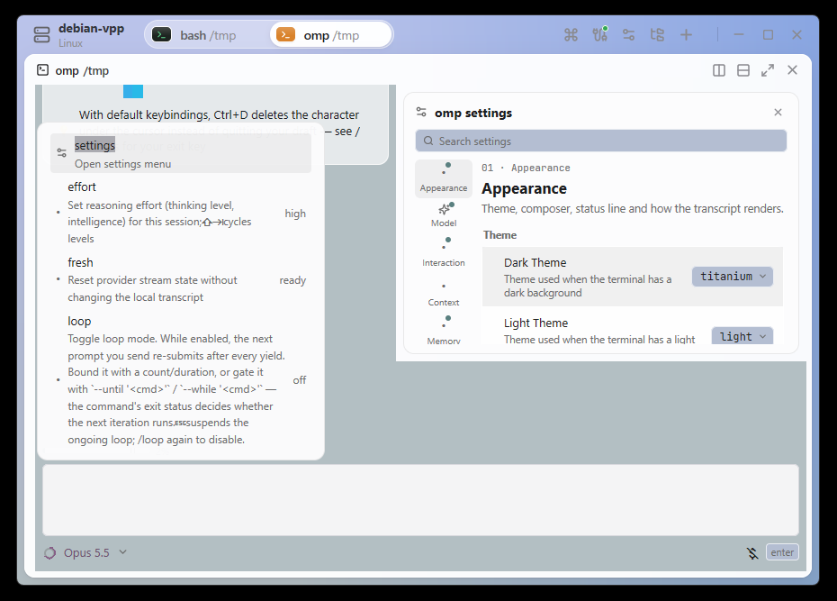

# GoRex

A replica of [Superlogical's Rex](https://www.superlogical.com/updates/public-testing-beginning)
terminal, written in Go with [MyGo](https://mygo.egoist.dev)'s native UI and its
terminal plugin (Ghostty's libghostty-vt). No webview, no cgo: one ~15 MB app.



## What it does

- **Tabs and split panes.** Every pane is a card over the window's gradient,
  with its program's icon, name and directory in its header, and buttons to
  split right, split down, zoom and close. Drag the gaps between panes to
  resize them (double-click resets a split to half).
- **Persistent sessions.** Shells run in a session server, a background
  process of the same binary (`GoRex -server`). Quit GoRex and everything
  keeps running; open it again and every tab, split and pane comes back as
  it was, programs still running. The server keeps each session's screen in
  a headless libghostty-vt emulator and sends a snapshot on attach, so
  full-screen programs (lazygit, vim, htop…) come back exactly.
- **Program activity.** The server watches each terminal's foreground
  process (`tcgetpgrp`, `sysctl`, `proc_pidinfo`; on Windows, the shell's
  newest child, its command line and directory): headers and tabs name the
  program (`Node`, `Git Changes` for lazygit, `Codex`, `SSH host`…) and its
  working directory, a green dot shows a program printing, and an orange dot
  marks a pane whose program finished or rang the bell out of sight. When
  the window is in the background, a long command finishing posts a
  notification.
- **Tab icons** stack the tiles of a tab's programs, the focused pane's in
  front, as Rex does. Tabs reorder by dragging, rename by double-click, and
  have a context menu.
- **Host chip** with the machine's name and model; its popover shows the
  chip, memory, OS and the session server, and lists the hosts: click one
  to switch the window to it, ⧉ to open it in a new window, ↻ to reconnect,
  ✕ (on hover) to forget it, or type `user@host` to connect to another.
- **Command palette** (⇧⌘P, Ctrl+Shift+P, or the ⌘ button): every command, and every pane
  to jump to, fuzzy-matched; the servers to switch the window to (below).
- **Remote sessions over ssh.** `GoRex ssh user@host` opens a window on
  the sessions of a GoRex server on that host, as VS Code's Remote-SSH
  does: GoRex copies the server for the host's system to `~/.cache/gorex/<id>/` there the
  first time, starts it, and carries every connection over one `ssh`
  (multiplexed with yamux, by `GoRex -bridge` on the host). The remote
  server keeps its state, the layout too, in `~/.config/<profile>`, the
  profile being the name of the local data directory (`GoRex`, `GoRex
  Dev`). The host chip's popover, or the palette (type `ssh user@host`),
  switches the window to another host or back to this machine. A lost
  connection comes back by itself, trying five times; a bar under the
  panes tells how it goes, with Retry once it gave up, and the Connection
  Log (also in the palette) shows what ssh said. Remote hosts run Linux
  (glibc 2.28 or later) or macOS, on amd64 or arm64, and ssh logs in with
  keys or an agent, never a password. A window opened with `GoRex ssh`
  quits when it is closed, on macOS too; the server and its sessions go on.
- **Settings** (⌘, / Ctrl+,): a dialogue with a sidebar and a search over
  every row. The look of a window follows the host it shows: appearance,
  terminal colors (every Ghostty theme, with a previewer), tint, font,
  cursor; set on a host, they apply from any PC. Hosts without a value of
  their own inherit this PC's Defaults. The shell, where new tabs start,
  the environment and the scrollback are the host's own; notifications,
  confirm-on-close, copy on select and reconnecting are this PC's.

## Shortcuts

| macOS | Windows, Linux | |
|---|---|---|
| ⌘T | Ctrl+Shift+T | New tab |
| ⌘D / ⇧⌘D | Ctrl+Shift+D / Ctrl+Shift+E | Split right / down |
| ⌘W / ⇧⌘W | Ctrl+Shift+W | Close pane / tab |
| ⇧⌘↩ | Ctrl+Shift+Enter | Zoom the pane |
| ⌥⌘ arrows | Alt+arrows | Focus the pane in that direction |
| ⌃⌘ arrows | Alt+Shift+arrows | Move the nearest divider |
| ⌃⌘= | | Equalize panes |
| ⌘1…⌘9, ⇧⌘[ ⇧⌘], ⌃Tab | Ctrl+Shift+1…9, Ctrl+PageUp/PageDown, Ctrl+Tab | Switch tabs |
| ⇧⌘R | Ctrl+Shift+R | Rename tab |
| ⇧⌘P, ⌘P | Ctrl+Shift+P | Command palette |
| ⌘K | Ctrl+Shift+K | Clear |
| ⌘+ ⌘− ⌘0 | Ctrl+= Ctrl+- Ctrl+0 | Text size |
| ⌥⌘Q | | Quit and end all sessions |

Elsewhere than on macOS, Control and a letter are the terminal's (Ctrl+C,
Ctrl+D, Ctrl+W…), so GoRex's shortcuts take Shift too, as copying and
pasting do (Ctrl+Shift+C, Ctrl+Shift+V), and none take Control and Alt,
which type characters (AltGr) on many keyboards.

## Develop and build

GoRex needs [Go](https://go.dev/dl/) 1.27+ and MyGo 0.3.0, whose CLI
`go.mod` pins as a tool:

```sh
go tool mygo dev     # GoRex Dev, rebuilt and restarted as the code changes
go test ./...        # the server, and the view without a window
go tool mygo build   # build/darwin-arm64/GoRex.app and a .dmg
go run ./tools/mkicon  # redraw resources/icon.png
go run ./tools/remotepayload  # the servers for ssh hosts, in resources/remote (mygo build runs it)
```

`go get -tool github.com/egoist/mygo/cmd/mygo@latest` updates MyGo and its
CLI together.

The app keeps its state in its data directory: the server's socket and
log, `layout.json`, the host's `settings.json` and this PC's
`defaults.json`, in `~/Library/Application
Support/GoRex` for the built app and `GoRex Dev` for `mygo dev`'s, so
that developing never touches the sessions of the app you use
(`GOREX_DIR` names another directory). The sessions outlive the app, but
not a rebuild: a development build replaces a server that an older build
started, ending its sessions, which then start again in the same
directories. That goes for the servers it reaches over ssh too: the first
connection after a rebuild copies the new build to the host and restarts
the `GoRex Dev` server there, ending its sessions.

### Windows

GoRex runs on Windows 10 1809 or later, whose ConPTY runs the shells; its
data directory is `%AppData%\GoRex`. Panes run `$SHELL` when it names a
Windows program (`nu`, `C:\Program Files\Git\bin\bash.exe`), else
PowerShell (`pwsh`, then `powershell`), else `cmd`. PowerShell's `cd`
leaves its process's directory where it was, so GoRex starts it with a
prompt that sets it, wrapping the profile's own prompt: the header then
follows it, and new panes open there. The window is frameless and its
title bar draws minimize, maximize and close with the other buttons; it
resizes from its sides and bottom, not its top.

## Layout

| | |
|---|---|
| `main.go` | the app, its window, `-server` and `-bridge` |
| `bind.go`, `remotes.go` | the server a window shows: connecting, reconnecting, switching, known remotes |
| `state.go` | tabs, the tree of splits, panes, saving and restoring the layout |
| `view.go`, `tabs.go`, `host.go`, `commands.go` | the interface: title bar, tabs, panes, host popover, menus and palette |
| `programs.go` | how programs show: names, glyphs, tile colors |
| `style.go`, `settings.go`, `settings_app.go`, `settings_view.go` | colors, fonts, terminal themes; the settings' layers, their dialogue and the theme picker |
| `internal/rex` | the session server and its client: PTYs, foreground processes, headless screens, the socket protocol, the ssh bridge |
| `internal/remote` | reaching a server over ssh: copying the host's server there, the multiplexed link |

`go run ./tools/remotepayload` builds the servers GoRex copies to ssh
hosts, one archive per platform in `resources/remote/` (Linux and macOS,
amd64 and arm64), each with the libghostty-vt of the MyGo that `go.mod`
pins, from MyGo's download cache or a `replace`d checkout. `mygo build`
runs it first, as `mygo.json`'s `buildCommand`, so a build never ships
servers older than itself (`-skip-build-command` skips it); for `mygo dev`
run it by hand. `mygo build` and `mygo dev` ship them next to the
executable, so hosts never download anything; without them, ssh
connections fail, telling to run the tool.

Icons: [Lucide](https://lucide.dev) (ISC) and [Simple Icons](https://simpleicons.org)
(CC0). Font: [JetBrains Mono](https://www.jetbrains.com/lp/mono/) (OFL). The ssh
link is multiplexed by [yamux](https://github.com/hashicorp/yamux) (MPL-2.0),
unmodified.
